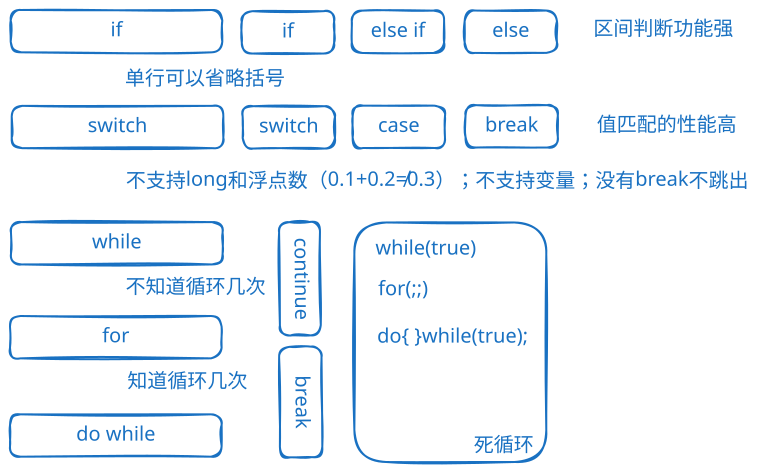

# 专题：Java控制结构

## 控制结构选择指南

1. **顺序结构**：程序从上到下逐行执行，是最基本的控制结构。
2. **分支结构**：[branch](details/branch.md)
    - 简单条件：if-else
    - 多值匹配：switch
    - 复杂条件：if-else if
3. **循环结构**：[loop](details/loop.md)
    - 已知循环次数：for
    - 未知循环次数：while
    - 至少执行一次：do-while
4. **循环控制语句**：[loop2](details/loop2.md)
    * break
    * continue
    * return
    * 递归

## 最佳实践

1. 避免过深的嵌套（建议不超过3层）
2. switch语句记得加break防止穿透
3. 循环中合理使用break和continue控制流程
4. 多重循环使用标签提高可读性
