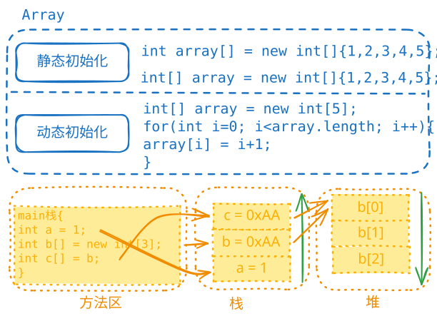

# 数组基础

## 数组初始化方式



1. **方式1**：直接初始化
   ```java
   double[] hens = {3, 5, 1, 3.4, 2, 50};
   ```

2. **方式2**：C风格声明
   ```java
   double hens[] = {3, 5, 1, 3.4, 2, 50};
   ```

3. **方式3**：使用new关键字
   ```java
   double[] hens = new double[]{3, 5, 1, 3.4, 2, 50};
   ```

4. **方式4**：先声明后分配空间
   ```java
   double[] hens;           // 声明
   hens = new double[6];    // 分配空间
   // hens[0] = 1;          // 赋值
   ```

5. **错误方式**：不能同时指定大小和元素
   
   ```java
   double hens[] = new double[6]{3, 5, 1, 3.4, 2, 50};// 错误写法
   ```

**注意**：方式1、2、3是等价的。

## 数组入门案例：找最大值

```java
double[] num = {1.0, 20.4, 11.4, 13};
double max = num[0];
for (int i = 0; i < num.length; i++) {
    if (num[i] > max) {
        max = num[i];
    }
}
System.out.println("max = " + max);
```
