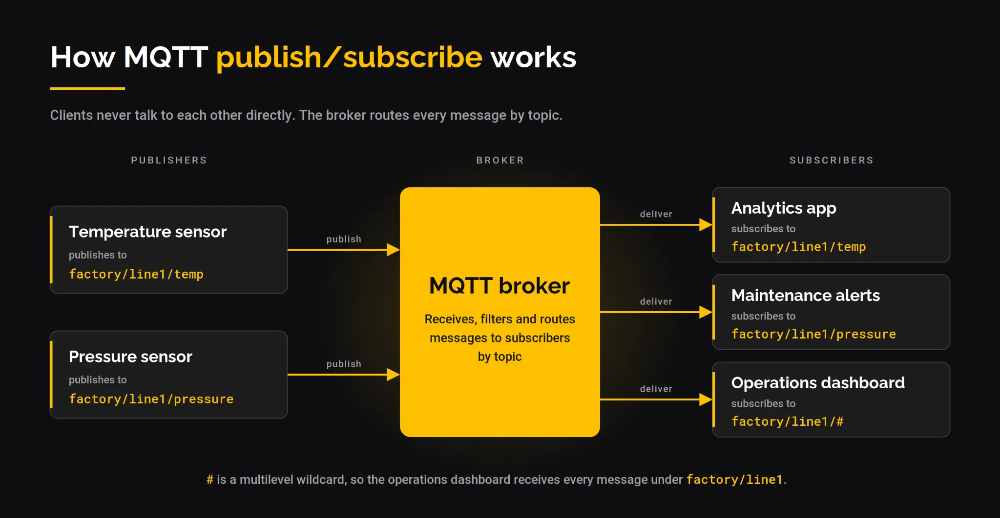

# MQTT5 第一章 引言

## 关键词

- **Network Connection**：底层传输协议提供的构造，连接 Client 和 Server，提供双向有序、无损的字节流。非规范示例见 4.2。
- **Application Message**：MQTT 为应用传输的数据，包含 payload、QoS、一组属性、Topic Name。
- **Client**：使用 MQTT 的程序或设备。开连接、发布、订阅、取消订阅、关连接。
- **Server**：发布方与订阅方之间的中介。接受连接、接受发布、处理订阅/取消订阅、转发匹配消息、关闭连接。
- **Session**：Client 与 Server 之间的有状态交互。有的只持续到连接结束，有的可跨越连续的多条连接。
- **Subscription**：由 Topic Filter 和最大 QoS 组成，关联单个 Session。一个 Session 可有多个订阅，每个订阅的 Topic Filter 不同。
- **Shared Subscription**：由 Topic Filter 和最大 QoS 组成，可关联多个 Session。匹配的消息只发给其中一个 Session 对应的 Client。一个 Session 可订阅多个共享订阅，也可同时有共享和非共享订阅。
- **Wildcard Subscription**：Topic Filter 中含一个或多个通配符的订阅，可匹配多个 Topic Name。通配符说明见 4.7。
- **Topic Name**：附在 Application Message 上的标签，与 Server 已知的订阅匹配。
- **Topic Filter**：订阅中的表达式，表示对一个或多个主题的兴趣，可含通配符。
- **MQTT Control Packet**：网络连接上发送的信息包。规范定义十五种类型，例如 PUBLISH 用于传递 Application Message。
- **Malformed Packet**：无法按规范解析的控制包。错误处理见 4.13。
- **Protocol Error**：包解析成功后，发现数据不被协议允许、或与 Client/Server 状态不一致。错误处理见 4.13。
- **Will Message**：网络连接非正常关闭时，由 Server 发布的 Application Message。见 3.1.2.5。
- **Disallowed Unicode code point**：不应包含在 UTF-8 编码字符串中的 Unicode 控制码和非字符集合。见 1.5.4。

## 编码

> 这个就是mqtt报文内部数据的编码方式，我们使用的客户端服务器实现会实现好下面的编码方式。

- **1.5.3 四字节整数**：32 位无符号，大端序，高位字节在前。
- **1.5.4 UTF-8 编码字符串**：两字节长度前缀 + UTF-8 数据，最大 65,535 字节。强制要求：格式良好 UTF-8，不得含 U+D800–U+DFFF；不得含 U+0000；`0xEF 0xBB 0xBF` 必须解释为 U+FEFF，不得跳过或剥离。
- **1.5.5 可变字节整数**：每字节低 7 位存数据，最高位是延续位（1 表示还有后续字节），最多 4 字节，编码值必须用最少字节表示。
- **1.5.6 二进制数据**：两字节长度前缀 + 数据，0–65,535 字节。
- **1.5.7 UTF-8 字符串对**：两个 UTF-8 字符串依次排列，第一个是名称，第二个是值。两者都必须符合 1.5.4 的要求。

## MQTT 3.1.1 与 5.0 关键变化对照

| 维度           | MQTT 3.1.1             | MQTT 5.0 新增/变化                                                                                                                                                                                     | 对应已读/将读的位置             |
| ------------ | ---------------------- | -------------------------------------------------------------------------------------------------------------------------------------------------------------------------------------------------- | ---------------------- |
| **错误报告**     | 确认报文几乎没有失败原因           | **原因码（Reason Code）** 扩展到约 20 个，CONNACK、PUBACK、DISCONNECT 等都可携带                                                                                                                                     | 第三章各报文的可变报头            |
| **会话控制**     | 只有 Clean Session 一个布尔值 | 拆成 **Clean Start** + **Session Expiry Interval** 两个独立控制                                                                                                                                            | 第三章 CONNECT 属性、第四章会话状态 |
| **属性系统**     | 不存在                    | 报文可变报头可携带**属性（Properties）** 键值对，是 v5.0 大量新特性的载体                                                                                                                                                    | 第二章固定报头之后、第三章每个报文      |
| **用户自定义元数据** | 只能塞进 payload           | **User Property**：任意 UTF-8 键值对，可在多数控制报文中传输                                                                                                                                                         | 第三章各报文属性区              |
| **主题传输优化**   | 每次发完整 Topic 字符串        | **Topic Alias**：用整数别名代替长 Topic，减少重复传输的字节数                                                                                    | 第三章 PUBLISH 属性         |
| **消息生命周期**   | 无过期概念                  | **Message Expiry Interval**：发布时指定消息有效期，过期后 Broker 不再投递                                                                       | 第三章 PUBLISH 属性         |
| **流控**       | 不存在                    | **Receive Maximum**：协商“我最多能同时处理多少个未确认的 QoS 1/2 消息”                                                                                                                                                 | 第三章 CONNECT 属性         |
| **请求/响应模式**  | 需应用层自行约定               | **Response Topic + Correlation Data**：PUBLISH 属性中直接携带响应主题和关联标识                                                               | 第三章 PUBLISH 属性         |
| **遗嘱精细控制**   | 断线立即发遗嘱                | **Will Delay Interval**：指定断线后延迟 N 秒再发遗嘱，期间重连则不发送 | 第三章 CONNECT 遗嘱属性       |
| **认证扩展**     | 只有 CONNECT 中的用户名/密码    | 新增 **AUTH 报文**，支持挑战-响应式多轮认证                                                                                                       | 第三章 AUTH 报文（第十五种类型）    |
| **共享订阅**     | 不支持（需额外机制）             | 原生支持：多个订阅者订阅同一共享 Topic，消息只发给其中一个                                                                                                                                                                   | 第三章 SUBSCRIBE、第四章分发规则  |

## 发展与核心[1]

> 本节的内容是MQTT的发展历程，参考自四篇博客。

* **1999**：诞生于卫星遥测场景，用于在昂贵卫星链路上监控 SCADA 系统与管道等远程资产。
* **MQTT 3.1.1（2014）**：推动 IoT 从 HTTP 轮询转向结构化发布/订阅，覆盖智能家居、智能电表、移动应用与消息服务。
* **MQTT 5.0（2019）**：面向企业级与云集成的协议。典型联网车队每秒约产生 10 万条消息，单个智能工厂每秒可产生 2.5 万至 5 万条。
* **数据骨干阶段**：MQTT 成为统一命名空间（UNS）、OT/IT 融合、分析与数字孪生的中心。
* **当前两端延伸**：MQTT-SN 将消息传递扩展至卫星、NB-IoT 等远边缘设备，支持牲畜追踪、应急响应等应用；同时 MQTT 也被用于连接企业内的 AI 智能体。

| 协议         | 适合场景               | 核心能力                 |
| ---------- | ------------------ | -------------------- |
| MQTT 3.1.1 | IoT 设备和遥测          | 简单、广泛支持的发布/订阅        |
| MQTT 5.0   | 企业和云集成             | 增强认证、请求/响应、用户属性、共享订阅 |
| MQTT-SN    | 远边缘（UDP、卫星、NB-IoT） | 为需要功耗优化的小型设备提供小足迹    |
各个版本不变的内容：

具体而言下面展开进行介绍

### 标准化前期（1999 - 2012）[2]

**从工业设备采集数据的轮询方法**旨在避免同一网络上的多台设备同时尝试发送数据时发生数据包冲突。每个设备制造商都希望在竞争中率先将产品推向市场，不愿因参与或等待标准的出台而耽误时间，因此各自开发了自己的方法。

轮询依赖于服务器定期联系所有连接的设备，无论这些设备所持有的数据是否发生了变化。即使设备的数据很少变化，服务器也可能因与大量设备通信而不堪重负。

Arlen Nipper（当时任职于 Arcom Control Systems）和 IBM 的 Andy Stanford-Clark 于 1999 年初起草了 **MQTT 的第一个版本**。当时它被称为“Argo Lightweight On The Wire Protocol”，Argo 是 IBM 的一个产品代号。它的主要目标是摆脱当时存在的“数百种专有轮询/响应协议的传统”。它是后来成为 MQTT 的雏形，当时还没有 DISCONNECT、UNSUBSCRIBE 或 PING 消息。

版本 1 存在的时间不长。Arlen 和 Andy 在那年晚些时候定义了[版本 2](http://stanford-clark.com/MQIpdp/)，并将名称改为“MQ Integrator Pervasive Device Protocol”（MQIpdp）。[版本 2 中引入的变更](http://stanford-clark.com/MQIpdp/versions.html)使其看起来非常像我们今天所熟知的 MQTT 3.1.1，首次增加了遗嘱消息、保活处理以及取消订阅的能力。

[版本 3](http://stanford-clark.com/MQTT/) 于次年，即 2000 年推出，包含了一些小的变更和澄清，这些内容在接下来的十年里一直保持稳定，直到 2010 年版本 3.1 问世。在这十年间，MQTT 在 Arcom 和 IBM 的各种项目中得到了采用，包括：

- **2000 年**：Arcom Control Systems 的“Director”——支持 MQTT 的工业网络网关
- **2002 年**：SCADA Mousetrap（Andy SC）
- **2004 年**：IBM Microbroker——一个 Java MQTT 代理实现
- **2005 年**：UIB——一个用于与 MQTT 数据交互的智能手机应用（Bharat Bedi）
- **2006 年**：[MQTT.org 上线](https://web.archive.org/web/20060208044144/http://mqtt.org/)
    - IA92 Java 客户端
    - IA93 C 参考实现
    - Websphere MQ
    - MQ Message and Event Broker  
    - Websphere Business Integration Message Broker
    - CPAN Websphere::MQTT::Client
    - Combichem（Dr. Jeremy Frey）
- **2007 年**：RSMB——一个用 C 编写的极简 MQTT 代理（Ian Craggs）
- **2007 年**：家庭用电和用水监测（Andy SC）
- **2009 年**：怀特岛 Redjet 渡轮状态发布在 Twitter 上（Andy SC）
- **2009 年**：会发推特的房子（Andy SC）
- **2010 年**：开源 Mosquitto 项目（Roger Light） 
- **2010 年**：IBM 和 Eurotech 发布了 [MQTT 3.1](https://public.dhe.ibm.com/software/dw/webservices/ws-mqtt/mqtt-v3r1.html)，其中做了以下变更：
    - 用户名和密码现在可以随 CONNECT 数据包一起发送 
    - CONNACK 数据包中新增了针对安全问题的返回码
    - 明确了客户端不会被告知未经授权的 PUBLISH 或 SUBSCRIBE 命令，并且即使命令未被执行，正常的 MQTT 流程也应完成
    - 字符串现在支持完整的 [UTF-8](https://datatracker.ietf.org/doc/html/rfc2044)，而不仅仅是 US-ASCII 子集
- **2011 年**：用于 Facebook Messenger
- **2011 年**：开源 Eclipse Paho 项目
- **2012 年**：Chale 社区项目
- **2012 年**：IBM MessageSight
- **2012 年**：Mosquitto 加入 Eclipse 基金会

此时，MQTT 的使用已经足够广泛，标准化成为社区的首要任务，以确保其未来的成功。

###  How MQTT 3.1.1 Was Standardized[3]

书接上文，此时，来自众多方面的声音都在呼吁 MQTT 的标准化，包括 IBM 的客户、行业提供商和用户。其采用受到了 IBM 所有权的阻碍。IBM 不太可能以突然或出乎意料的方式改变 MQTT，但这种可能性确实存在。

2013 年 3 月 26 日，OASIS MQTT 技术委员会（TC）的启动会议在波士顿的 EclipseCon 上举行，同时为无法亲自到场的人安排了在线会议。IBM 的 Scott De Deugd 做了介绍，Chet Ensign 代表 OASIS 欢迎大家。IBM 的 Richard Coppen 和 Raphael Cohn 当选为联合主席。M2MI 的创始人 Geoff Brown 当选为秘书。多位 M2MI 代表出席了 TC，包括 Julien Niset 和 Louis-Philippe Lamoureux，他们二人在 MQTT 3.1.1 标准化期间负责记录会议纪要。会议记录是一项必要但耗时且不起眼的工作，因此他们的努力深受感激。

出席第一次会议的有来自 IBM、M2MI Corp、dc-square（后来的 HiveMQ）、Cisco Systems、WSO2、Eurotech、Software AG、Open Geospatial Consortium、Solace Systems、Landis+Gyr、Red Hat、INETCO 和 Cimetrics 的代表。Richard 提议从 2013 年 4 月 11 日星期四开始每两周召开一次会议——于是在星期四举行 TC 会议的惯例就此诞生。

此时，MQTT 是“Message Queuing Telemetry Transport”的缩写，并被纳入了 OASIS TC 的名称中。在标准化过程中，TC 一致同意，从那时起 MQTT 将不再是一个缩写，而是作为一个独立的协议名称。

制定了一个非常激进的时间表，目标是在不到一年的时间内产出一个标准化的 MQTT。为此，只考虑对输入的 MQTT 3.1 规范做小的修改，正如委员会章程（主要由 IBM 的 Peter Niblett 撰写）中所概述的那样：

* 与 MQTT 3.1 的向后兼容性至关重要  
* 尽量减少对现有实现的干扰  
* 任何会破坏向后兼容性的需求或建议都应记录在案，留待未来的重大修订  
* 除澄清和编辑性修改外，更新仅允许以向后兼容的方式对 Connect 命令进行  

为确保只考虑核心特性，并避免可能偏离时间表的冗长讨论，一些主题被明确界定为范围之外：

* MQTT 功能到任何编程语言或特定消息中间件的映射  
* 协议的参考实现  
* 根据规范发布的消息的有效载荷格式（与 MQTT 协议直接相关的值和字段除外）  
* 标准化的 MQTT 主题名称  
* 任何用于对主题或主题空间进行分类的 MQTT 特定机制或约定  
* 在输入规范之上不添加任何安全特性  

在对联合主席 Richard Coppen 的采访中，他说有很多流程需要学习。Richard 和另一位联合主席 Raphael Cohn 都是 OASIS 的新手。拥有丰富 OASIS 经验的 Peter Niblett 以及 OASIS 工作人员在支持主席们驾驭标准化之旅方面提供了极大的帮助。在接下来的一年里，他们召开了 50 多次 TC 会议，大多通过电话会议进行，因为各个团队成员分布在世界各地。

经验丰富的 OASIS 工作人员，如 Chet Ensign，认为在一年内完成首次标准化是不可能的——他们以前从未见过这样的事。这件事在很大程度上得以实现（审查和错误更正使其延长到 18 个月），证明了所有参与者的积极性和投入，尤其是联合主席们创造了所需的势头，以及 IBM 的编辑 Andrew Banks 和 Rahul Gupta 所做的一贯努力。

TC 的许多成员都做出了持续而重大的贡献。在本文中尚未提及的人当中，我想再强调一些在此期间参与识别和解决问题的人：M2MI 的 Sarah Cooper、IBM 的 Nick O'Leary 和 Peter Niblett。

**安全小组委员会**

Geoff Brown 和 M2MI 非常关注 MQTT 的安全需求和影响，并且是安全小组委员会（SC）成立的关键。由于 MQTT 叠加在 TCP/IP 和 TLS 之上，大部分注意力都放在该层面上保护通信。

SC 的工作成果是安全章节以及规范中也引用的委员会说明《MQTT 与 NIST 网络安全框架 1.0 版》。关键成员包括来自 M2MI 的 Geoff Brown、Sarah Cooper、Julien Niset 和 Louis-Philippe Lamoureux，以及 IBM 的 Allan Stockdill-Mander。

规范章节概述了 MQTT 实现将面临的风险，并参考其他安全和密码学标准提出了如何降低这些风险的建议。尽管该章节列出了创建 MQTT 解决方案时应考虑的攻擊类型，但在标准发布后，恰恰围绕这些主题提出了若干 CVE。

委员会说明“向实现者和高级管理人员介绍了 NIST 改进关键基础设施网络安全框架及其与 MQTT 安全建议的关系”。Louis-Philippe Lamoureux 和 Allan Stockdill-Mander 因“他们在草案上所做的出色工作”而受到明确感谢。

**技术咨询委员会审查**

2014 年 2 月 2 日至 6 日期间，OASIS 技术咨询委员会（TAB）的 Patrick Durusau 和 Jacques Durand 在对第一份 MQTT 委员会规范草案（CSD）的审查中报告了 57 个以上的问题。TC 没有预料到如此详细的反馈，以为 MQTT 草案几乎已经准备就绪。TC 随后在接下来的两个月里安排了更频繁的每周会议，以处理新产生的问题积压。由于 TAB 的勤勉，规范得到了显著改进，对此深表感谢。

**最终步骤与反响**

TAB 审查完成并解决其提出的问题后，第二份公开审查草案于 2014 年 4 月完成。在 2014 年 5 月 29 日的 TC 会议上，收到了来自以下各方的使用声明：

*  Software AG  
* IBM  
* HiveMQ  
* 2lemetry

随后对候选标准进行了投票并获得批准。OASIS 要求至少来自不同方的三份使用声明，以表明候选标准是可实现的，并广泛实现了其设定的目标，包括与其他实现的互操作。第一份候选 OASIS 标准于 2014 年 6 月产出。为期 60 天的公开审查（OASIS 的另一项要求）从 2014 年 7 月 7 日持续到 9 月 4 日。审查结果提出了一些小修改建议，但没有重要到需要再进行一轮公开审查的程度。

2014 年 11 月 13 日，MQTT 3.1.1 被宣布为 OASIS 标准。虽然完整的标准化过程比最初目标的一年要长，但计入公开审查期和其他 OASIS 要求后，这仍以创纪录的时间完成了。

**提交 ISO**

2015 年 4 月 7 日，TC 投票一致赞成将 MQTT 3.1.1 规范提交给 ISO/IEC JTC1 委员会。随后进行了为期 30 天的 ISO 成员审查，于 5 月 30 日结束——未收到任何意见。经过适当程序，ISO/IEC 标准于 2016 年 6 月发布。这是新技术标准缩短的时间框架和简化的流程——后续的 MQTT 版本将不再适用。

MQTT 3.1.1 的标准化绝非易事，而是该协议历史上的一个关键里程碑。在我们的系列中，到目前为止我们已经从 1999 年走到了 2014 年，接下来是：MQTT 5.0（2015-2018）。

###  MQTT 5.0: The Next Generation of MQTT[4]

在上一篇博文中，我们介绍了 MQTT 的标准化以及委员会为实现标准化而制定的雄心勃勃的时间表。现在我们将分享塑造了今天众所周知的 MQTT 的协议改进和增强的故事。

在 MQTT 3.1.1 标准化期间，人们就考虑到了未来的版本。有数十项改进建议或新的 MQTT 特性不符合 TC 的章程，被记录为“未来”问题。整个 2015 年，这些问题被讨论和记录。它们被拆分和重新组织，以提供一套连贯的改进，可以按优先级排序和分组。

2015 年 7 月，来自微软的几位额外人员加入了 TC，目标是影响 MQTT 的新版本。一年前，微软软件架构师 Clemens Vasters 写了一篇博文，严厉批评 MQTT 3.1.1。Clemens 是从一位经验丰富的 AMQP 标准化者和实践者的角度来写的，在他看来，MQTT 显得极其有限和不足。在那篇文章中，他推测 MQTT 是被有意保持有限的。从某种意义上说，这是真的，但并非 Clemens 所推测的原因。MQTT 的商业理由是支持尽可能轻量级的设备，无论是在开发还是使用中。因此，它的局限性是一个关键的卖点，得到了整个 MQTT 社区的支持。

**问题**

2015 年 10 月 15 日至 11 月 4 日期间，举行了一次 TC 投票，以决定哪些问题应被优先考虑。每位 TC 成员被要求最多选择 10 个问题。投票结果如下：

还有 11 个问题没有获得任何票数。

为确定下一版 MQTT 的方法，安排了两个为期 3 天的面对面研讨会。第一次于 1 月 27 日至 29 日在 IBM Hursley Park 举行，第二次于 2016 年 4 月 11 日至 13 日在 Microsoft Bellevue 举行。

对于一些最初的参与者来说，他们的目标已经实现。在 2016 年 2 月 25 日的 TC 会议上，Geoff Brown 和其他 M2MI 参与者辞去了秘书角色并离开了 TC。Geoff Brown 发了这条消息：

“M2Mi 认为，让其他人担任秘书而不是 M2Mi 持续担任默认角色是健康的……这很有趣，然而我认为规范已经达到了它需要达到的位置，因此我们的输入和支持不再需要了。”

**新章程**

在 2016 年 6 月 16 日的 TC 召集人会议上，举行了新章程下的第一次聚会。选举了新的主席、秘书和编辑，分别是：

* Richard Coppen 和 Brian Raymor
* Ian Craggs
* Ken Borgendale、Andrew Banks 和 Rahul Gupta

Brian 加入 Richard 担任联合主席，接替 Raph Cohn。在 MQTT 3.1.1 中作为编辑做了出色工作的 Andrew 和 Rahul，迎来了 Ken Borgendale 的加入。Ian Craggs 自愿担任秘书，并且无人反对，这并不令人意外，因为这不是一个抢手的角色。

Raph Cohn 因在 3.1.1 标准化期间作为联合主席的努力和投入而受到感谢。

新章程允许各种此前在 3.1.1 中被禁止的变更。只有以下项目被宣布为范围之外：

* MQTT 到任何编程语言或特定消息中间件的映射。
* 参考实现。
* 规定消息的有效载荷格式。
* MQTT 主题或主题空间的定义和分类。
* 额外的强制性安全特性——假定传输层（TCP/IP）安全。

过去一年中在 JIRA 问题中处理和记录的增强建议被收集在一起，并筛选为几个主题：

* 可扩展性和大规模系统的增强
* 改进的错误报告
* 形式化常见观察到的模式——例如请求响应
* 扩展机制——例如消息格式
* 性能改进——例如受限设备

**版本号**

MQTT 只有一个字节用于版本号。**MQTT 3.1.1 在连接数据包中使用值 4 以区别于版本 3**。这在谈论实现时导致了混淆，因此决定将所有未来版本的标准版本号与连接数据包对齐。由于 4 已经被使用，**5 是下一个**。如果将来有后续版本，将是 6。

6 月底，Richard 整理了一个 MQTT 5 的示例时间表，显示完成日期为 2017 年 4 月。那个激进的时间表是一个崇高的目标，但考虑到 3.1.1 之上所有额外的可能变更，是乐观的。

2016 年 9 月 26 日至 28 日，在 IBM Hursley 又举行了一次为期三天的面对面研讨会，以在问题和规范工作草案上取得进一步快速进展。从这次研讨会结束到 2017 年中期，剩余的问题被解决和纳入，规范的详细文本被修订和更正。任何参与起草必须清晰准确的文档的人都会知道最后阶段需要付出多少努力。

2017 年 8 月 9 日，新 MQTT 5.0 版的第一次公开审查宣布，于 9 月 8 日结束。考虑到此次更新中纳入的变更数量，这是一个成功的结果。

这次审查产生了大量反馈。最重要的问题是遗嘱消息上遗漏了属性，这是之前根本没有考虑到的。其余的是不一致、遗漏和轻微的排版更正。这种自由提供的反馈对于改进标准是无价的，感谢所有为此付出努力的人。

2018 年 4 月 19 日发布了一份关于处理不允许的 Unicode 码点的委员会说明。这影响了两个版本的 MQTT，并且在 3.1.1 时间框架内就已被观察到。

到 2018 年 7 月，回应之前所有关切的新 MQTT 草案已经准备就绪。TC 在等待使用声明——这是 OASIS 标准化过程的必要部分。TC 已经收到了来自 HiveMQ 和 VerneMQ 的声明。IBM 正在准备自己的声明。代表 Eclipse Paho 项目的 Ian Craggs 正在等待 Eclipse 基金会的批准。

2018 年 11 月 15 日宣布了对新的 OASIS 候选标准的公开审查，于 2019 年 1 月 14 日结束。有一些小疑问和评论，但没有被认为重要到足以延迟发布的。

MQTT V5.0 标准于 2019 年 3 月 21 日发布。需要注意的是，MQTT 3.1.1 并未因此被弃用，两个版本共存，并预计将在未来的解决方案中部署。

## 参考资料

1. [ MQTT 迎来 27 周年：为什么协议现在变得更加重要](https://www.hivemq.com/blog/history-of-mqtt/)
2. [The Origin of MQTT](https://www.hivemq.com/blog/the-history-of-mqtt-part-1-the-origin/)
3. [The History of MQTT: How MQTT 3.1.1 Was Standardized](https://www.hivemq.com/blog/the-history-of-mqtt-part-2-mqtt-3-standardization/)
4. [MQTT 5.0: The Next Generation of MQTT](https://www.hivemq.com/blog/the-history-of-mqtt-part-3-mqtt5-next-generation-mqtt/)
