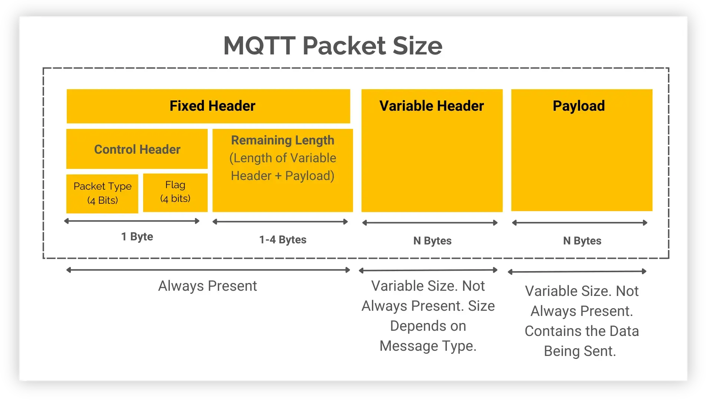
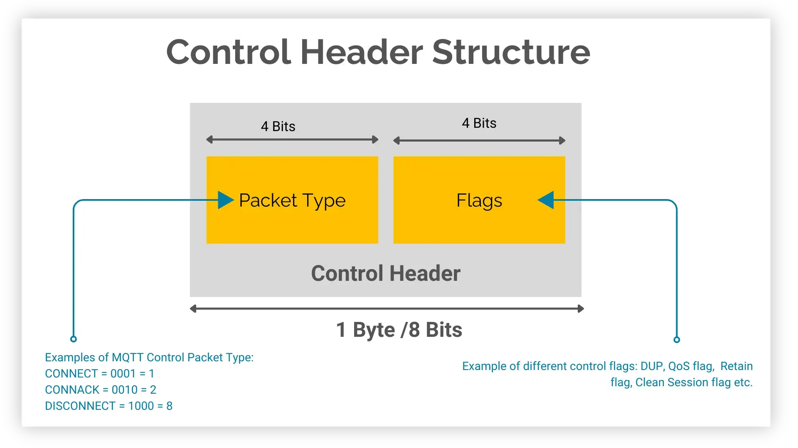
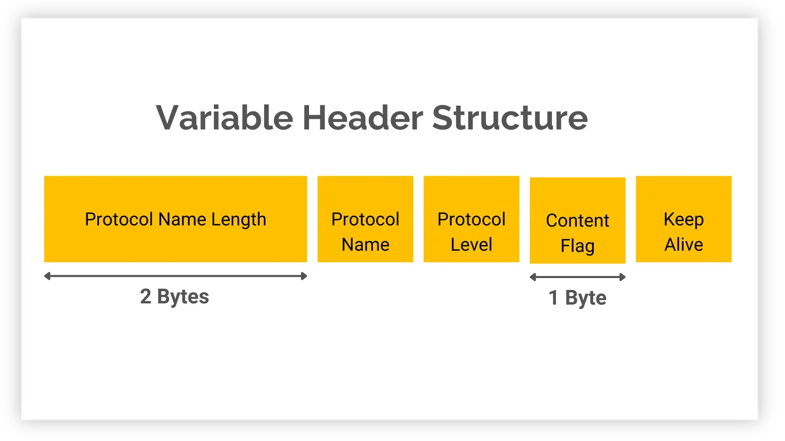

# MQTT5 第二章 控制包格式

## MQTT 数据包整结构

[1]

主要包含三部分：
1. 固定头（Fixed Header）
    1. 控制字段（Control Field）
        1. 报文类型（Packet Type，第 1 字节高 4 位）
        2. 标志位（Flags，第 1 字节低 4 位）
    2. 剩余长度（Remaining Length，可变字节整数编码）
2. 可变头（Variable Header）：内容随报文类型而定，如报文标识符、主题名、属性。
3. 载荷（Payload）：内容随报文类型而定，如消息内容、客户端 ID。

## 固定头（Fixed Header）

[1]

### 报文类型（Packet Type）

|  **Name**   | **Value** |            **Direction of flow**            |             **Description**              |
| :---------: | :-------: | :-----------------------------------------: | :--------------------------------------: |
|  Reserved   |     0     |                  Forbidden                  |                 Reserved                 |
|   CONNECT   |     1     |              Client to Server               |            Connection request            |
|   CONNACK   |     2     |              Server to Client               |          Connect acknowledgment          |
|   PUBLISH   |     3     | Client to Server or  Server to Client |             Publish message              |
|   PUBACK    |     4     | Client to Server or  Server to Client |      Publish acknowledgment (QoS 1)      |
|   PUBREC    |     5     | Client to Server or  Server to Client | Publish received (QoS 2 delivery part 1) |
|   PUBREL    |     6     | Client to Server or  Server to Client | Publish release (QoS 2 delivery part 2)  |
|   PUBCOMP   |     7     | Client to Server or  Server to Client | Publish complete (QoS 2 delivery part 3) |
|  SUBSCRIBE  |     8     |              Client to Server               |            Subscribe request             |
|   SUBACK    |     9     |              Server to Client               |         Subscribe acknowledgment         |
| UNSUBSCRIBE |    10     |              Client to Server               |           Unsubscribe request            |
|  UNSUBACK   |    11     |              Server to Client               |        Unsubscribe acknowledgment        |
|   PINGREQ   |    12     |              Client to Server               |               PING request               |
|  PINGRESP   |    13     |              Server to Client               |              PING response               |
| DISCONNECT  |    14     | Client to Server or  Server to Client |         Disconnect notification          |
|    AUTH     |    15     |    Client to Server or Server to Client     |         Authentication exchange          |
### 标志位（Flags）

Flags 只有 PUBLISH 用到，其他报文都填固定值。

| **MQTT Control Packet** | **Fixed Header flags** | **Bit 3** |       **Bit 2**       | **Bit 1** | **Bit 0** |
| :---------------------: | :--------------------: | :-------: | :-------------------: | :-------: | :-------: |
|         CONNECT         |        Reserved        |     0     |           0           |     0     |     0     |
|         CONNACK         |        Reserved        |     0     |           0           |     0     |     0     |
|         PUBLISH         |   Used in MQTT v5.0    |    DUP    | QoS (this & next bit) |           |  RETAIN   |
|         PUBACK          |        Reserved        |     0     |           0           |     0     |     0     |
|         PUBREC          |        Reserved        |     0     |           0           |     0     |     0     |
|         PUBREL          |        Reserved        |     0     |           0           |     1     |     0     |
|         PUBCOMP         |        Reserved        |     0     |           0           |     0     |     0     |
|        SUBSCRIBE        |        Reserved        |     0     |           0           |     1     |     0     |
|         SUBACK          |        Reserved        |     0     |           0           |     0     |     0     |
|       UNSUBSCRIBE       |        Reserved        |     0     |           0           |     1     |     0     |
|        UNSUBACK         |        Reserved        |     0     |           0           |     0     |     0     |
|         PINGREQ         |        Reserved        |     0     |           0           |     0     |     0     |
|        PINGRESP         |        Reserved        |     0     |           0           |     0     |     0     |
|       DISCONNECT        |        Reserved        |     0     |           0           |     0     |     0     |
|          AUTH           |        Reserved        |     0     |           0           |     0     |     0     |
* 详细内容可以看 [section 3.3.1](https://docs.oasis-open.org/mqtt/mqtt/v5.0/os/mqtt-v5.0-os.html#_CONNECT_Fixed_Header)
    * DUP = Duplicate delivery of a PUBLISH packet
    * QoS = PUBLISH Quality of Service
    * RETAIN = PUBLISH retained message flag

### 剩余长度（Remaining Length）

标准这里写的很罗嗦，其实就是，后两部分的长度和：
**剩余长度 = 这条报文里，固定头之后所有字节的数量**。

## 可变头（Variable Header）

[1]

> 可变头就像每种报文的“专属表格”：类型一定，该填哪几栏、每栏填什么就都定了，换一种报文换一张表。

### 报文标识符（Packet  Identifier）

**“报文标识符字段”是** MQTT 报文可变头里的一个 **2 字节整数**，用来把“请求”和“对应的确认”配对。
* 有报文标识符：PUBLISH（QoS > 0）、PUBACK、PUBREC、PUBREL、PUBCOMP、SUBSCRIBE、SUBACK、UNSUBSCRIBE、UNSUBACK
* 无报文标识符：CONNECT、CONNACK、PINGREQ、PINGRESP、DISCONNECT、AUTH

**报文标识符的分配与回收规则**。拆成四条：
1. **什么时候必须有**：PUBLISH 在 QoS > 0 时必须带；QoS 0 时不得带。客户端发 SUBSCRIBE、UNSUBSCRIBE、PUBLISH（QoS > 0）时，必须分配一个**当前未使用的非零**标识符。服务器发 PUBLISH（QoS > 0）也一样。
2. **什么时候可以回收**：发送方处理完对应的确认报文后，这个标识符才能再次使用。QoS 1 的 PUBLISH 对应 PUBACK；QoS 2 的 PUBLISH 对应 PUBCOMP，或者原因码 ≥ 128 的 PUBREC；SUBSCRIBE / UNSUBSCRIBE 分别对应 SUBACK / UNSUBACK。
3. **谁和谁共享一套**：PUBLISH、SUBSCRIBE、UNSUBSCRIBE 用的是**同一个池子**，但客户端和服务器**各自独立**维护自己的池子。所以同一时刻，一个标识符不能被同一个发送方的两条命令同时占用，但客户端用 0x1234 和服务器用 0x1234 互不影响。
4. **确认报文必须回同一个号**：PUBACK / PUBREC / PUBREL / PUBCOMP 必须带上原 PUBLISH 的标识符；SUBACK / UNSUBACK 必须带上原 SUBSCRIBE / UNSUBSCRIBE 的标识符。

### 属性（Properties）

> 属性系统是 MQTT5 新增的内容。

**一、属性放在哪**  

CONNECT、CONNACK、PUBLISH、PUBACK、PUBREC、PUBREL、PUBCOMP、SUBSCRIBE、SUBACK、UNSUBSCRIBE、UNSUBACK、DISCONNECT、AUTH 这 13 种报文的可变头最后一个字段是属性集合。CONNECT 的载荷里还有一组 Will Properties（遗嘱属性），结构相同。

**二、属性集合长什么样**

- 结构：属性长度（可变字节整数）+ 若干属性。
- 属性长度：不包含它自己占的字节，只数后面属性部分的字节数。没有属性时写 0，不能省略。
- 单个属性：标识符（可变字节整数）+ 值。标识符决定属性是什么、值是什么类型。当前版本所有属性标识符都只占 1 个字节。
- 出错处理：报文出现不该有的标识符，或值类型不对，即为 Malformed Packet，回 CONNACK 或 DISCONNECT，原因码 0x81。
- 顺序：属性之间顺序无所谓。

**三、下面的大表。**  

表里每一行是一个属性的定义：十进制编号、十六进制编号、名称、值类型、能出现在哪些报文里。比如 0x11 是 Session Expiry Interval，四字节整数，只能出现在 CONNECT、CONNACK、DISCONNECT；0x23 是 Topic Alias，两字节整数，只能出现在 PUBLISH。

| **Identifier** |         | **Name (usage)**                  | **Type**              | **Packet / Will Properties**                                                                                                            |
| -------------- | ------- | --------------------------------- | --------------------- | --------------------------------------------------------------------------------------------------------------------------------------- |
| **Dec**        | **Hex** |                                   |                       |                                                                                                                                         |
| 2              | 0x02    | Message Expiry Interval           | Four Byte Integer     | PUBLISH, Will Properties                                                                                                                |
| 3              | 0x03    | Content Type                      | UTF-8 Encoded String  | PUBLISH, Will Properties                                                                                                                |
| 8              | 0x08    | Response Topic                    | UTF-8 Encoded String  | PUBLISH, Will Properties                                                                                                                |
| 9              | 0x09    | Correlation Data                  | Binary Data           | PUBLISH, Will Properties                                                                                                                |
| 11             | 0x0B    | Subscription Identifier           | Variable Byte Integer | PUBLISH, SUBSCRIBE                                                                                                                      |
| 17             | 0x11    | Session Expiry Interval           | Four Byte Integer     | CONNECT, CONNACK, DISCONNECT                                                                                                            |
| 18             | 0x12    | Assigned Client Identifier        | UTF-8 Encoded String  | CONNACK                                                                                                                                 |
| 19             | 0x13    | Server Keep Alive                 | Two Byte Integer      | CONNACK                                                                                                                                 |
| 21             | 0x15    | Authentication Method             | UTF-8 Encoded String  | CONNECT, CONNACK, AUTH                                                                                                                  |
| 22             | 0x16    | Authentication Data               | Binary Data           | CONNECT, CONNACK, AUTH                                                                                                                  |
| 23             | 0x17    | Request Problem Information       | Byte                  | CONNECT                                                                                                                                 |
| 24             | 0x18    | Will Delay Interval               | Four Byte Integer     | Will Properties                                                                                                                         |
| 25             | 0x19    | Request Response Information      | Byte                  | CONNECT                                                                                                                                 |
| 26             | 0x1A    | Response Information              | UTF-8 Encoded String  | CONNACK                                                                                                                                 |
| 28             | 0x1C    | Server Reference                  | UTF-8 Encoded String  | CONNACK, DISCONNECT                                                                                                                     |
| 31             | 0x1F    | Reason String                     | UTF-8 Encoded String  | CONNACK, PUBACK, PUBREC, PUBREL, PUBCOMP, SUBACK, UNSUBACK, DISCONNECT, AUTH                                                            |
| 33             | 0x21    | Receive Maximum                   | Two Byte Integer      | CONNECT, CONNACK                                                                                                                        |
| 34             | 0x22    | Topic Alias Maximum               | Two Byte Integer      | CONNECT, CONNACK                                                                                                                        |
| 35             | 0x23    | Topic Alias                       | Two Byte Integer      | PUBLISH                                                                                                                                 |
| 36             | 0x24    | Maximum QoS                       | Byte                  | CONNACK                                                                                                                                 |
| 37             | 0x25    | Retain Available                  | Byte                  | CONNACK                                                                                                                                 |
| 38             | 0x26    | User Property                     | UTF-8 String Pair     | CONNECT, CONNACK, PUBLISH, Will Properties, PUBACK, PUBREC, PUBREL, PUBCOMP, SUBSCRIBE, SUBACK, UNSUBSCRIBE, UNSUBACK, DISCONNECT, AUTH |
| 39             | 0x27    | Maximum Packet Size               | Four Byte Integer     | CONNECT, CONNACK                                                                                                                        |
| 40             | 0x28    | Wildcard Subscription Available   | Byte                  | CONNACK                                                                                                                                 |
| 41             | 0x29    | Subscription Identifier Available | Byte                  | CONNACK                                                                                                                                 |
| 42             | 0x2A    | Shared Subscription Available     | Byte                  | CONNACK                                                                                                                                 |
## 载荷（Payload）

一些 MQTT 控制包包含一个有效载荷作为包的最后部分。

必需：CONNECT、SUBSCRIBE、SUBACK、UNSUBSCRIBE、UNSUBACK  
可选：PUBLISH  
无：CONNACK、PUBACK、PUBREC、PUBREL、PUBCOMP、PINGREQ、PINGRESP、DISCONNECT、AUTH

## 原因码（Reason Code）

**原因码（Reason Code）**：1 字节无符号值，表示操作结果。

- 小于 0x80：成功。成功通常写 0。
- 0x80 及以上：失败。

**带原因码的报文分两种放法：**

- 可变头里放**一个**原因码：CONNACK、PUBACK、PUBREC、PUBREL、PUBCOMP、DISCONNECT、AUTH。
- 载荷里放**一组**原因码：SUBACK、UNSUBACK。

| **Reason Code** |         | **Name**                               | **Packets**                                           |
| --------------- | ------- | -------------------------------------- | ----------------------------------------------------- |
| **Decimal**     | **Hex** |                                        |                                                       |
| 0               | 0x00    | Normal disconnection                   | DISCONNECT                                            |
| 0               | 0x00    | Granted QoS 0                          | SUBACK                                                |
| 1               | 0x01    | Granted QoS 1                          | SUBACK                                                |
| 2               | 0x02    | Granted QoS 2                          | SUBACK                                                |
| 4               | 0x04    | Disconnect with Will Message           | DISCONNECT                                            |
| 16              | 0x10    | No matching subscribers                | PUBACK, PUBREC                                        |
| 17              | 0x11    | No subscription existed                | UNSUBACK                                              |
| 24              | 0x18    | Continue authentication                | AUTH                                                  |
| 25              | 0x19    | Re-authenticate                        | AUTH                                                  |
| 128             | 0x80    | Unspecified error                      | CONNACK, PUBACK, PUBREC, SUBACK, UNSUBACK, DISCONNECT |
| 129             | 0x81    | Malformed Packet                       | CONNACK, DISCONNECT                                   |
| 130             | 0x82    | Protocol Error                         | CONNACK, DISCONNECT                                   |
| 131             | 0x83    | Implementation specific error          | CONNACK, PUBACK, PUBREC, SUBACK, UNSUBACK, DISCONNECT |
| 132             | 0x84    | Unsupported Protocol Version           | CONNACK                                               |
| 133             | 0x85    | Client Identifier not valid            | CONNACK                                               |
| 134             | 0x86    | Bad User Name or Password              | CONNACK                                               |
| 135             | 0x87    | Not authorized                         | CONNACK, PUBACK, PUBREC, SUBACK, UNSUBACK, DISCONNECT |
| 136             | 0x88    | Server unavailable                     | CONNACK                                               |
| 137             | 0x89    | Server busy                            | CONNACK, DISCONNECT                                   |
| 138             | 0x8A    | Banned                                 | CONNACK                                               |
| 139             | 0x8B    | Server shutting down                   | DISCONNECT                                            |
| 140             | 0x8C    | Bad authentication method              | CONNACK, DISCONNECT                                   |
| 141             | 0x8D    | Keep Alive timeout                     | DISCONNECT                                            |
| 142             | 0x8E    | Session taken over                     | DISCONNECT                                            |
| 143             | 0x8F    | Topic Filter invalid                   | SUBACK, UNSUBACK, DISCONNECT                          |
| 144             | 0x90    | Topic Name invalid                     | CONNACK, PUBACK, PUBREC, DISCONNECT                   |
| 145             | 0x91    | Packet Identifier in use               | PUBACK, PUBREC, SUBACK, UNSUBACK                      |
| 146             | 0x92    | Packet Identifier not found            | PUBREL, PUBCOMP                                       |
| 147             | 0x93    | Receive Maximum exceeded               | DISCONNECT                                            |
| 148             | 0x94    | Topic Alias invalid                    | DISCONNECT                                            |
| 149             | 0x95    | Packet too large                       | CONNACK, DISCONNECT                                   |
| 150             | 0x96    | Message rate too high                  | DISCONNECT                                            |
| 151             | 0x97    | Quota exceeded                         | CONNACK, PUBACK, PUBREC, SUBACK, DISCONNECT           |
| 152             | 0x98    | Administrative action                  | DISCONNECT                                            |
| 153             | 0x99    | Payload format invalid                 | CONNACK, PUBACK, PUBREC, DISCONNECT                   |
| 154             | 0x9A    | Retain not supported                   | CONNACK, DISCONNECT                                   |
| 155             | 0x9B    | QoS not supported                      | CONNACK, DISCONNECT                                   |
| 156             | 0x9C    | Use another server                     | CONNACK, DISCONNECT                                   |
| 157             | 0x9D    | Server moved                           | CONNACK, DISCONNECT                                   |
| 158             | 0x9E    | Shared Subscriptions not supported     | SUBACK, DISCONNECT                                    |
| 159             | 0x9F    | Connection rate exceeded               | CONNACK, DISCONNECT                                   |
| 160             | 0xA0    | Maximum connect time                   | DISCONNECT                                            |
| 161             | 0xA1    | Subscription Identifiers not supported | SUBACK, DISCONNECT                                    |
| 162             | 0xA2    | Wildcard Subscriptions not supported   | SUBACK, DISCONNECT                                    |

## 参考资料

1. [MQTT 数据包：全面指南](https://www.hivemq.com/blog/mqtt-packets-comprehensive-guide/)